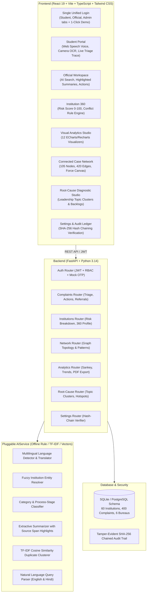

# AICTE Complaint Intelligence Hub (CIH)

**Tagline:** *One institution, one complaint view, across every bureau and cell.*  
**Statutory Authority:** All India Council for Technical Education (AICTE), Ministry of Education, Govt. of India.

---

## 🏛️ System Architecture



---

## 🚀 Quick Start (One Command)

### Prerequisites
- Python 3.10+ (tested on Python 3.14)
- Node.js 18+ (tested on Node v24)
- npm

### 1. Launch Everything
On Windows, double-click or run:
```cmd
start.bat
```
*Or run backend and frontend in separate terminals:*

**Terminal 1 (Backend):**
```bash
cd backend
python -m uvicorn app.main:app --host 127.0.0.1 --port 8000 --reload
```

**Terminal 2 (Frontend):**
```bash
cd frontend
npm run dev -- --host 127.0.0.1 --port 5173
```

- **Frontend Portal:** [http://127.0.0.1:5173](http://127.0.0.1:5173)
- **FastAPI Interactive Docs:** [http://127.0.0.1:8000/docs](http://127.0.0.1:8000/docs)

---

## 🔄 Reset Seed Data (Single Command)

To reset the database and re-seed all 60 institutions, 400 complaints across 12 months, deliberate patterns, and the cryptographic audit ledger:

```bash
python run_reset.py
```
*(or `python -m backend.app.seed_data --reset`)*

---

## 🔑 Demo Personas & Credentials

| Role Tab | Persona Name | Role / Level | Bureau / State | Login Credentials |
| :--- | :--- | :--- | :--- | :--- |
| **Student** | Aarav Sharma | Student Complainant | Madhya Pradesh | Mobile: `9876543210`<br/>Mock OTP: `123456` |
| **Official** | Vikram Malhotra | Case Officer | Finance Bureau | `officer.finance@aicte.gov.in`<br/>Password: `DemoPass@123` |
| **Official** | Dr. Sunita Deshmukh | Bureau Head | Finance Bureau | `head.finance@aicte.gov.in`<br/>Password: `DemoPass@123` |
| **Official** | Rajeshwar Verma | Regional Officer | Madhya Pradesh | `ro.mp@aicte.gov.in`<br/>Password: `DemoPass@123` |
| **Admin** | Prof. Anil Sahasrabudhe | Leadership (Chairman's Office) | National (All Bureaus) | `admin@aicte.gov.in`<br/>Password: `DemoPass@123` |

> [!NOTE]
> **1-Click Demo Mode:** Every persona is selectable with a single click in the top banner of the login page or through the floating **Demo Guide** drawer in the header.

---

## 🌟 Deliberate Intelligence Patterns Seeded

1. **Inter-State Caution Money Cluster (`GRP-2025-REFUND-01`):** A shared systemic fee refund failure across 3 colleges in 2 states (*Apex Institute Indore*, *Bhopal Engineering Academy*, and *Vidarbha Tech Nagpur*).
2. **Chronic Repeat Offender:** *Apex Institute of Technology & Management* (`AICTE-1-1002931`) with 20+ complaints and risk score `88.5 / 100`.
3. **Cross-Bureau Conflict Alert:** *National College of Engineering Pune* (`AICTE-1-1004520`) has an Extension of Approval (EoA) renewal in progress in Approval Bureau while 3 serious harassment/ragging and fake faculty complaints remain open in Student Welfare and Inspection Cell.
4. **Active High Court Stay:** *Vanguard Institute Bengaluru* (`AICTE-1-1005611`) with an active High Court interim stay holding penalty recovery.
5. **Opposing Bureau Orders:** *Imperial Polytechnic Lucknow* (`AICTE-1-1008899`) received a provisional extension from Approval Bureau while Inspection Cell issued a closure order for laboratory deficiencies.
6. **Month-by-Month Backlog Growth:** Inspection Cell active backlog steadily escalates from 8 to 24 overdue cases across 12 months.

---

## 🛠️ Technology Stack

- **Frontend:** React 19, Vite, TypeScript, Tailwind CSS, IBM Plex Sans, Apache ECharts, Recharts, Lucide Icons, `react-i18next` (6 languages: EN, HI, MR, BN, TA, TE), `tesseract.js` for in-browser OCR, Web Speech API (speech recognition and text-to-speech), `getUserMedia` camera capture.
- **Backend:** FastAPI, Python 3.14, SQLAlchemy, SQLite (PostgreSQL compatible schema), Bcrypt password hashing, PyJWT authentication, Scikit-learn TF-IDF & cosine vector similarity, ReportLab PDF generation.
- **Security:** Tamper-evident SHA-256 hash chaining on all audit logs (`hash = SHA256(prev_hash + timestamp + user + action + details)`).
