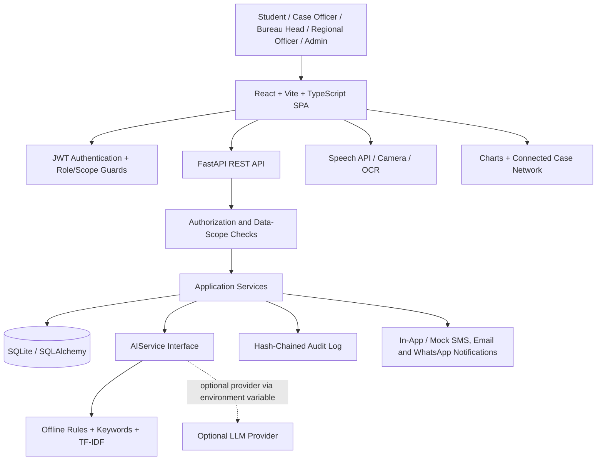
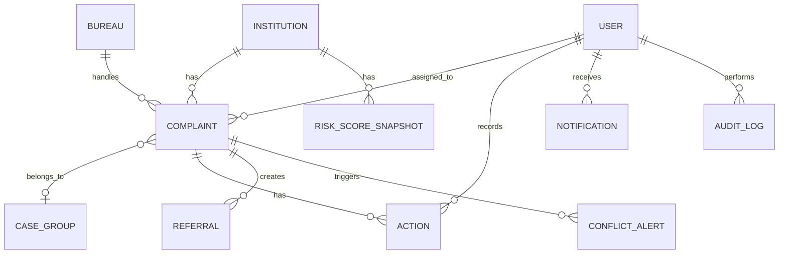

# AICTE Complaint Intelligence Hub (CIH) — Architecture

**Tagline:** One institution, one complaint view, across every bureau and cell.  
**Problem statement:** Integrated dashboard for monitoring and tracking institution-related complaint cases across AICTE Bureaus/Cells.

## 1. Architecture Goals

- Make the **institution** the central entity: every complaint should link to an AICTE Institution ID.
- Give authorized users a consolidated view of complaint history, status, risk, related cases and pending actions.
- Support cross-Bureau coordination, duplicate/related-case detection, SLA monitoring and conflict alerts.
- Keep the prototype fully usable offline through a rule/keyword/TF-IDF AI implementation.
- Enforce permissions in both frontend routes and backend data queries.
- Make AI outputs explainable, reviewable and auditable.

## 2. Technology Stack

| Layer | Technology | Responsibility |
|---|---|---|
| Web frontend | React, Vite, TypeScript | SPA, role-based screens and workflows |
| Styling/accessibility | Tailwind CSS, IBM Plex Sans | Responsive government-grade UI, focus states and large-text option |
| Charts | Apache ECharts, Recharts | Analysis studio, dashboards and simple charts |
| Relationship map | `react-force-graph-2d` or Cytoscape.js with fcose | Connected Case Network |
| Localization | `react-i18next` | English, Hindi, Marathi, Bengali, Tamil and Telugu |
| Maps | Leaflet | Geographic views where applicable |
| API | FastAPI (Python) | REST endpoints and authorization |
| ORM/database | SQLAlchemy, SQLite | Prototype persistence; schema designed to be PostgreSQL-compatible |
| Authentication | JWT + role-based access control | Sign-in and permission enforcement |
| AI layer | Pluggable `AIService` | Offline language tagging, translation hook, triage, classification, similarity, summaries and insights |
| Browser capabilities | Web Speech API, `getUserMedia`, `tesseract.js` | Speech, camera capture and basic OCR |
| Testing | pytest plus frontend tests | API, permissions, workflow and UI checks |

## 3. High-Level System Diagram

## 4. Application Layers

### 4.1 Frontend
- One login page with three tabs: **Student**, **Official**, and **Admin/Leadership**.
- Role-specific home screens after login.
- Shared header with language switcher, light/dark mode, notification centre and accessibility controls.
- Student portal: file complaint, voice assistance, evidence capture/OCR, status timeline and closure feedback.
- Official workspace: inbox, case details, AI triage trace, summary verification, actions, referrals and SLA tracker.
- Institution 360: institution identity, approval/renewal details, risk factors, complaint history and conflict alerts.
- Analysis Studio and Connected Case Network for permitted roles.
- Frontend route guards improve navigation, but are not the security boundary; backend checks remain mandatory.

### 4.2 Backend
FastAPI is organized into routers, schemas, models and service modules. API handlers validate input and call services; services enforce permissions and business rules before reading or changing records.

Suggested API groups:
- `/api/auth/*` — login, demo mode, mock OTP and current user.
- `/api/institutions/*` — institution search and Institution 360.
- `/api/complaints/*` — submission, list, details, status and tracking.
- `/api/triage/*` — triage trace and officer overrides.
- `/api/cases/*` — case groups, related cases and conflict checks.
- `/api/actions/*` — action notes, templates and status transitions.
- `/api/referrals/*` — inter-Bureau requests and responses.
- `/api/reports/*` — filters, report data and authorized exports.
- `/api/network/*` — graph nodes, edges and pattern callouts.
- `/api/insights/*` — root-cause insight cards and evidence links.
- `/api/notifications/*` — notifications and mock delivery log.
- `/api/admin/*` — users, SLA/conflict rules and audit verification.

### 4.3 AIService
Every AI-dependent workflow calls a common interface, so the default offline implementation can be replaced without changing application routes.

Expected operations:
- `detect_language(text)`
- `translate(text, source_language, target_language="en")`
- `resolve_institution(query)`
- `classify_category(text)`
- `detect_process_stage(text)`
- `assess_severity_priority(text, context)`
- `suggest_bureau(text, category)`
- `assign_sla(category, priority)`
- `find_similar_cases(complaint, threshold)`
- `summarize_complaint(complaint)`
- `parse_natural_language_query(query)`
- `generate_root_cause_insights(records)`

The default implementation uses language tagging, a small offline dictionary, rules/keywords and TF-IDF/cosine similarity. Translation and summary quality must be clearly labelled according to the capability available; optional external LLM use is controlled by an environment variable. AI recommendations are not final regulatory decisions.

### 4.4 Data and audit
- SQLAlchemy models persist institutions, complaints, case groups, actions, referrals, bureaus, users, notifications, audit logs, conflict alerts and risk-score snapshots.
- Use foreign keys and indexes for institution IDs, complaint status, bureau, dates and case-group membership.
- Each audit entry stores the previous entry hash and its own hash; an admin action verifies the chain.
- Seed data is synthetic and clearly identified as demo data.
- One documented command resets and reseeds the prototype database.

## 5. Core Data Relationships

### Core entities
- **Institution:** AICTE ID, name, aliases, state, district, programs, approval status, renewal date, court-stay flag and penalties.
- **Complaint:** institution link, complainant details (maskable), channel, original text/language, English translation, category, Bureau, process stage, priority, severity, status, assigned officer, dates, SLA state, attachments, AI summary, similarity representation and case-group ID.
- **CaseGroup:** related complaints grouped for review; membership can be changed only through authorized workflow.
- **Action:** show-cause, penalty, court order, notes and supporting evidence.
- **Referral:** inter-Bureau request, response and timestamps.
- **User:** role (`student`, `official`, `admin`), level, bureau and/or state scope.
- **AuditLog:** actor, action, target, timestamp, previous hash and current hash.
- **ConflictAlert / RiskScoreSnapshot / Notification:** explainable alerts, dated risk calculations and user notifications.

## 6. Role and Data Access

| Role / level | Expected scope |
|---|---|
| Student | Own submitted complaints and related status/notifications; complainant privacy controls apply |
| Official — Case Officer | Cases assigned to the officer and permitted related-case context |
| Official — Bureau Head | Bureau cases, workload and SLA breaches |
| Official — Regional Officer | Cases within the assigned state |
| Admin/Leadership | National dashboard, root-cause insights, settings and audit log |

The database query layer must enforce role, level, Bureau and state restrictions on every relevant endpoint. Never rely only on hiding frontend components.

## 7. Complaint Triage and Case Workflow

1. Receive complaint text, institution query, channel and optional evidence.
2. Detect language and retain original text; provide English translation where available.
3. Resolve the institution to an AICTE ID with a confidence value.
4. Suggest category and process stage.
5. Assess severity and priority using transparent rules.
6. Suggest the responsible Bureau and assign an SLA.
7. Search for similar complaints and recommend a CaseGroup.
8. Update institution risk snapshot and check configured cross-Bureau conflict rules.
9. Display an AI triage trace with confidence/reasons.
10. Let an authorized officer verify or override recommendations; log each override.

Suggested complaint statuses: `open`, `under review`, `awaiting institution`, `sub-judice`, `resolved`, `penalty imposed`, `withdrawn`. Status transitions should be validated by the backend.

## 8. Institution 360 and Conflict Rules

Institution 360 consolidates approval status, renewal date, risk score with factor breakdown, complaint timeline across Bureaus, Bureau-wise status, court cases, penalties and linked case groups.

The rule engine should flag:
- Approval renewal in progress while unresolved fee or faculty complaints exist.
- Different directions issued by two Bureaus for the same institution.
- Active court stay where enforcement should be held for review.
- The same institution flagged by three or more Bureaus within 60 days.

Alerts are prompts for authorized human review; they do not automatically determine guilt or regulatory outcomes.

## 9. Reporting and Intelligence

- Filtered reports: Bureau pendency, category-wise, state-wise, SLA breaches, institution risk ranking and root-cause summaries.
- Visual analysis: Sankey, calendar heatmap, state choropleth, stacked area, treemap, radar, bubble chart, Bureau workload/SLA gauge, funnel, period comparisons, risky-institution leaderboard and AI insight strip.
- Connected Case Network: at least nine node types and ten edge types, graph filters, similarity threshold, timeline replay, cluster callouts, shortest path and exports.
- Root-Cause dashboard: complaint themes, period change, growing backlogs, recurring process issues and links to supporting complaints.
- Exports: CSV, Excel and PDF where permitted; every download is audit-logged.

## 10. Seed Data and Demo Scenario

Seed synthetic data for:
- 60 institutions and 400 complaints over 12 months.
- Six Bureaus: Approval, Academic, Examination and Quality, Finance, Inspection Cell and Student Welfare Cell.
- Eight categories: fee fraud, fake faculty, infrastructure, affiliation, admission irregularity, harassment/ragging, examination and approval-related.
- Deliberate patterns: a fee-refund issue across three institutions in two states; repeated fee complaints at one institution; renewal pending with serious open complaints; an institution with a court stay; conflicting actions from two Bureaus; and a Bureau with month-on-month backlog growth.

End-to-end demo:
1. Student submits a Hindi voice complaint with a camera photo of a fee receipt and a misspelled institution name.
2. Triage trace shows language handling, institution match, fee-fraud classification, Finance routing, SLA and a related-case cluster.
3. Case Officer verifies the AI summary and investigates a renewal/complaint conflict alert.
4. Officer explores the Connected Case Network and supporting complaints.
5. Officer searches for overdue fee complaints from the last three months in Madhya Pradesh and exports a report.
6. SLA breach escalates; Bureau Head and Admin dashboards update.
7. Admin reviews root-cause insights and verifies the audit chain.

## 11. Security, Reliability and Quality

- Passwords must be hashed; never store plaintext passwords.
- Use short-lived JWTs and validate permissions on the server.
- Validate file type and size; do not trust uploaded filenames.
- Mask complainant details for roles that do not need them.
- Keep demo data synthetic; do not use real complaint or student data in public demos.
- Provide loading, empty, success and actionable error states.
- Add tests for role boundaries, complaint submission, triage, case linking, SLA escalation, exports and audit verification.
- Configure secrets and optional AI provider through environment variables; commit only `.env.example`.
- Provide one-command startup and one-command seed reset.

## 12. Suggested Build Order

1. Foundation: database, seed data, single login, roles, localization and theme.
2. Student complaint submission and tracking.
3. Offline AI triage and trace.
4. Official workspace, actions, referrals and SLA.
5. Institution 360 and conflict alerts.
6. Search, reports and analysis studio.
7. Connected Case Network.
8. Root-cause dashboard.
9. Admin settings, audit verification and notifications.
10. Accessibility, responsive polish, tests and guided demo.

## 13. Architecture Acceptance Checks

- One login page with three role tabs and role-specific home screens.
- Student, Case Officer and Regional Officer cannot access unauthorized records.
- AI outputs expose reasons/confidence and can be reviewed or overridden.
- Summary fields link to supporting original text.
- Connected Case Network supports the required node/edge types, filters, timeline and pattern callouts.
- Reports and exports work on seeded data and downloads are audited.
- No dead buttons; database reset and demo setup are documented.
